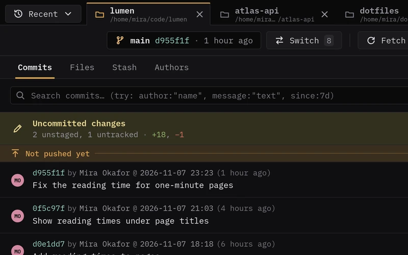
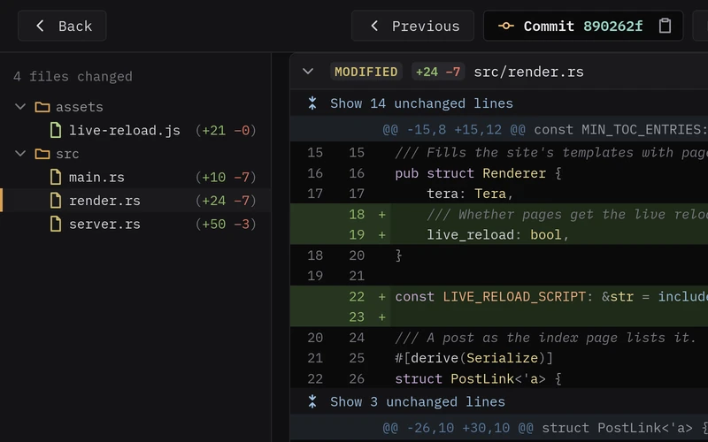
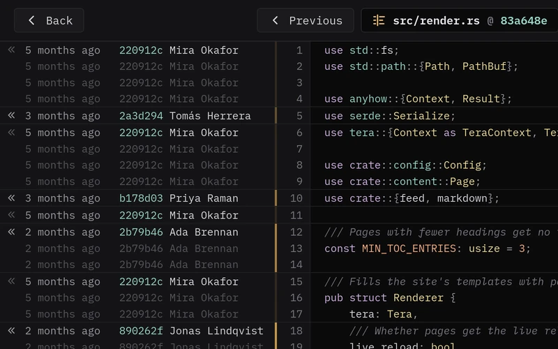
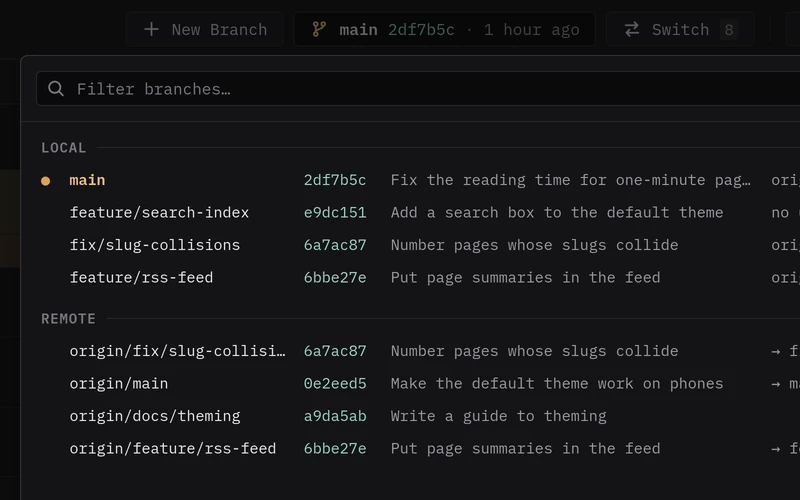
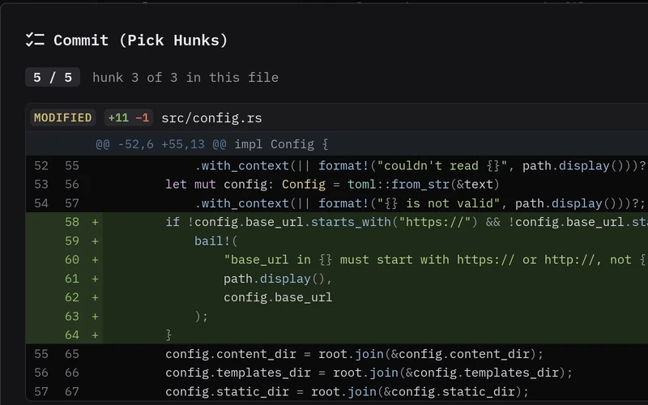
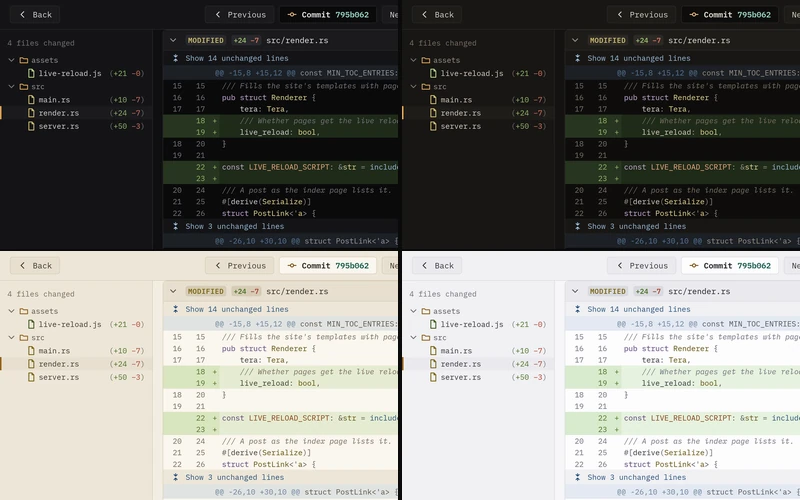

<p align="center">
  
</p>

<h1 align="center">GitEagle</h1>

<p align="center">
  GitEagle is a desktop viewer for Git repositories. It shows branches,
  history, diffs, blame and more. Each repository opens in a separate tab.
</p>

<p align="center">
  <a href="https://github.com/diath/giteagle/releases"><b>Download</b></a>
  a Windows installer or a Linux AppImage. GitEagle is free and open source.
</p>

<table>
  <tr>
    <td align="center">
      <a href="docs/screenshots/history.webp"></a>
      <br><b>History</b>
    </td>
    <td align="center">
      <a href="docs/screenshots/diffs.webp"></a>
      <br><b>Diffs</b>
    </td>
    <td align="center">
      <a href="docs/screenshots/blame.webp"></a>
      <br><b>Blame</b>
    </td>
  </tr>
  <tr>
    <td align="center">
      <a href="docs/screenshots/branches.webp"></a>
      <br><b>Branches</b>
    </td>
    <td align="center">
      <a href="docs/screenshots/pick-hunks.webp"></a>
      <br><b>Pick hunks</b>
    </td>
    <td align="center">
      <a href="docs/screenshots/themes.webp"></a>
      <br><b>Themes</b>
    </td>
  </tr>
</table>

# Features

- **[History](docs/screenshots/history.webp)** - The commit list shows the
  newest commits first. It marks the commits that are not pushed.
  Uncommitted changes are at the top of the list.
- **Tabs** - Each repository opens in a separate tab. When you start
  GitEagle, it opens all the tabs that were open when you closed it.
- **[Diffs](docs/screenshots/diffs.webp)** - GitEagle shows diffs with syntax
  highlighting and marks the words that changed. A tree shows the changed
  files. You can show the hidden lines with one click.
- **[Blame](docs/screenshots/blame.webp)** - Blame shows the commit that last
  changed each line, and it follows renames. You can also see the blame from
  before each change.
- **[Files](docs/screenshots/files.webp)** - The Files tab shows each file with
  the last commit that changed it. From this tab, you can open a file, its
  history or its blame.
- **[Search](docs/screenshots/search.webp)** - You can find commits by text.
  To get more specific results, use `author:`, `message:`, `file:` and
  `since:`.
- **[Branches](docs/screenshots/branches.webp)** - When you switch branches,
  GitEagle keeps the uncommitted changes that do not conflict, as
  `git checkout` does. You can fetch, pull and push with one click. Pull does
  only fast-forward merges. GitEagle also fetches in the background without
  prompts.
- **[Pick hunks](docs/screenshots/pick-hunks.webp)** - You can commit whole
  files, or you can select the changes hunk by hunk. The Y, N and Q keys have
  the same function as in `git add --patch`.
- **[Reword, squash, drop and move](docs/screenshots/squash.webp)** - You can
  change the messages of unpushed commits, squash them, drop them or move
  them up and down, as in `git rebase -i`. If a commit causes a conflict,
  nothing changes.
- **[Cherry-pick and revert](docs/screenshots/cherry-pick.webp)** - You can
  copy commits to other local branches without a checkout, or you can revert
  them. If a conflict occurs on one branch, no branch changes.
- **[Stashes](docs/screenshots/stashes.webp)** - GitEagle shows each stash as a
  diff. You can apply, pop or drop a stash. GitEagle applies a stash only if
  it does not cause a conflict or overwrite local changes.
- **[Authors](docs/screenshots/authors.webp)** - The Authors tab shows each
  person who worked on the branch. For each author, it shows the commits, the
  added and removed lines and the time of the last commit.
- **[Themes](docs/screenshots/themes.webp)** - There are four themes: Dark
  (Black), Dark (Brown), Light (Beige) and Light (White). GitEagle applies a
  theme immediately when you select it.

# Installation

You must have `git` on your `PATH`. If GitEagle cannot find `git`, it does not
start. GitEagle uses `git` for fetch, pull, push and blame. Because of this,
your credentials and SSH configuration apply.

## Pre-built binaries

Each release on the [releases page](https://github.com/diath/giteagle/releases)
has a Windows installer and a Linux AppImage. There is no macOS build at this
time.

To install GitEagle on Windows:

1. Run `GitEagle_<version>_x64-setup.exe`.
2. If SmartScreen shows a warning, click *More info*.
3. Click *Run anyway*.

SmartScreen can show a warning because the installer is not code-signed.

To run GitEagle on Linux:

1. Make the AppImage executable:

   ```sh
   chmod +x GitEagle_<version>_amd64.AppImage
   ```

2. Run the AppImage:

   ```sh
   ./GitEagle_<version>_amd64.AppImage
   ```

## From source

Before you start, install this software:

- Rust 1.91 or newer
- Node.js 24 and npm
- The Tauri CLI. To install it, run
  `cargo install tauri-cli --version "^2.12" --locked`.
- The system libraries for Tauri. Refer to
  [Tauri's prerequisites](https://v2.tauri.app/start/prerequisites/) for the
  list. On Debian and Ubuntu, use this command to install them:

  ```sh
  sudo apt install build-essential libwebkit2gtk-4.1-dev libappindicator3-dev librsvg2-dev patchelf xdg-utils
  ```

To build GitEagle:

1. Clone the repository:

   ```sh
   git clone https://github.com/diath/giteagle.git
   ```

2. Install the interface packages:

   ```sh
   cd giteagle/ui
   npm ci
   ```

3. Build GitEagle:

   ```sh
   cd ..
   cargo tauri build
   ```

The installer or the AppImage is in `target/release/bundle/`. The executable
is in `target/release/`. To build only the executable, add `--no-bundle` to
`cargo tauri build`.

To make changes to GitEagle, run `cargo tauri dev -- -- <path>`. This command
runs GitEagle on the repository at `<path>`. When you edit the interface,
GitEagle reloads it.

## With cargo install

To build and install GitEagle with cargo, run this command:

```sh
cargo install giteagle --locked
```

This command puts the `giteagle` executable in `~/.cargo/bin`. It does not add
a desktop entry or an icon.

Because the crate contains the built interface, Node.js and the Tauri CLI are
not necessary. You must have Rust 1.91 or newer. You must also have the system
libraries that [From source](#from-source) gives.

To install GitEagle from a clone:

1. In `ui/`, run `npm run build` to build the interface.
2. In the repository root, run `cargo install --path . --locked`.

## Run GitEagle

To start GitEagle, run this command:

```sh
giteagle [path]
```

When GitEagle starts, it opens all the repositories that were open when it
closed.

If you give a path, GitEagle also opens the repository that contains this
path. GitEagle looks for the repository in the folder of the path first. Then
it looks in each folder above it, as `git` does.

If you do not give a path, GitEagle shows the tab that you had open last. If
there are no tabs to open, it shows a tab that asks for a repository.

# Features Not Available

GitEagle is mainly a viewer. At this time, it does not have these features:

- Rebase onto a different branch.
- The functions of `git rebase -i` other than reword, squash, drop and
  changing the order of commits. For example, you cannot edit a commit.
- Merges, and an interface to resolve conflicts.
- Staging. GitEagle makes commits from the working tree, not from the index.
- Force push.
- Submodules.
- Git LFS.
- Bare repositories.
- Optimization for very large repositories. The commit list loads more commits
  when you scroll down. Other parts of GitEagle do not have optimization for
  large repositories.
- macOS builds.

# License

The [MIT License](LICENSE) applies to GitEagle.
